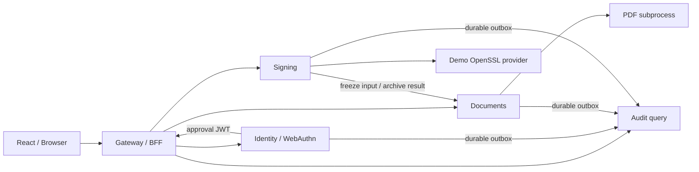

# สถาปัตยกรรม PSTON รุ่นพัฒนา

ใช้ Node.js/TypeScript เป็น Backend หลักและ React เป็น UI ตามการตัดสินใจล่าสุดของผู้ใช้ แยก 5 บริการใน monorepo เพื่อให้ผู้พัฒนาคนเดียวดูแล build และ tests ได้ แต่แต่ละบริการรันเป็น process/container ของตัวเอง มีข้อมูลและ service identity ของตัวเอง

## ขอบเขตความเชื่อถือ

Gateway เชื่อม browser session กับ owner ที่ได้จาก Identity เท่านั้น ไม่รับ `owner` ที่ client อ้างมา การเรียก API ที่เปลี่ยนข้อมูลต้องมี Origin ที่ตรงและ CSRF token; session อยู่ใน HttpOnly/SameSite cookie และเก็บเพียง hash ของ token ในฐานข้อมูล Identity Cookie ใช้ Secure เมื่อ origin เป็น HTTPS

Service JWT มี issuer/audience/purpose/expiry แยกตามบริการ อายุ 60 วินาที ทุกบริการตรวจลายเซ็นและ caller ก่อนเข้าถึงข้อมูล Internal prepare/archive ไม่อยู่ใน public route allowlist

Approval JWT ออกได้เฉพาะ Identity หลังตรวจ WebAuthn หรือ explicit demo confirmation Signing ไม่ยอมรับ approval ที่เซ็นด้วยกุญแจ Gateway จึงไม่ใช้ service credential แทนการอนุมัติผู้ใช้ อย่างไรก็ตาม native dev processes อยู่ใต้ OS user เดียวกันและ filesystem administrator ยังอ่านกุญแจได้ ขอบเขตนี้ไม่ทดแทน Production IAM/Cloud KMS; Compose แยก runtime volumes เพื่อฝึกการแยกสิทธิ์ในเครื่อง

## เส้นทางลงนาม

1. Documents เก็บ original bytes แบบไม่เขียนทับ และคำนวณ SHA-256
2. Draft ใช้ `draftVersion` ป้องกันการบันทึกจากแท็บเก่า
3. Preview สร้าง PDF จริงที่มีองค์ประกอบและ QR แล้ว เก็บ immutable bytes/hash ก่อนแสดงให้ผู้ใช้ตรวจ
4. Signing จอง idempotency key แบบ atomic แล้วให้ Documents เพิ่ม signature placeholder และเตรียม ByteRange digest จัดเก็บเป็นคนละ blob กับ preview
5. Manifest ผูก owner, request, prepared hash, digest, certificate, nonce และอายุ 5 นาที ส่วน WebAuthn challenge และ approval มีอายุ 2 นาที
6. Signing ตรวจ Identity approval ทุก claim เปลี่ยน `prepared → signing` ใน transaction ก่อนเรียก provider และตรวจ draft/bytes อีกครั้ง
7. Demo provider ใช้ OpenSSL CMS `-cades` กับ test key และประกอบ PDF โดยเติมเฉพาะส่วนลายเซ็นที่เตรียมไว้ เก็บผล provider ลงดิสก์ในเครื่อง หรือ Cloud Storage บน Cloud Run ก่อน archive
8. ตรวจ CMS signature, ByteRange coverage, digest และ certificate fingerprint แล้ว Documents บันทึก revision/hash/QR evidence และ audit outbox ใน transaction
9. สำเร็จเป็น `signed`; retry request เดิมคืน revision เดิม หากเริ่มเรียก provider แล้วผลไม่ชัดเจนเป็น `pending_review` และไม่เซ็นใหม่อัตโนมัติ

หาก process หยุดระหว่าง `signing` ระบบรอ request หมดอายุและ grace อีก 5 นาที ก่อนเปลี่ยนเป็น `pending_review` เมื่ออ่านสถานะ การเริ่ม instance ใหม่ไม่แก้สถานะงานของ instance อื่น การ reconcile ใช้ผล PDF เดิมที่บันทึกไว้และ archive แบบ idempotent หากไม่พบผลจะคืน `OUTCOME_UNKNOWN` เพื่อรอตรวจสอบ ไม่คาดเดาว่าสำเร็จ

การตรวจ OpenSSL ปัจจุบันเป็นการตรวจ cryptographic signature ใน subprocess แยก ยังไม่ใช่การยืนยันด้วย independent PDF engine หรือการรับรองความครบถ้วนของ PAdES profile ต้องตรวจเทียบ pyHanko/Acrobat และ CA policy ต่อก่อนเปิดใช้จริง ดูเอกสาร [OpenSSL CMS](https://docs.openssl.org/3.6/man1/openssl-cms/) และ [pyHanko validation](https://docs.pyhanko.eu/en/latest/cli-guide/validation.html)

## การจัดเก็บและ Audit

Local ใช้ SQLite ของแต่ละบริการ (WAL) ส่วน Cloud Run ใช้ PostgreSQL แยก database/login role ต่อบริการ โดยใช้ async transaction context และ advisory lock เพื่อ serialize ธุรกรรมสั้นของบริการเดียวกันข้าม instance state และ outbox commit พร้อมกัน ห้ามทำ RPC/PDF/object upload ระหว่างถือ lock

Cloud Run เก็บ blob ชื่อ UUID ใน bucket แยก Documents/Signing และสร้างด้วย precondition ifGenerationMatch=0 พร้อมตรวจ hash ก่อนอ่าน/ดาวน์โหลด Runtime มีสิทธิ์สร้าง/อ่านแต่ไม่มีสิทธิ์ลบหรือทับ object มี versioning/soft delete แต่ metadata ยังอ้าง object name + hash ไม่ใช่ pinned generation ไม่มี cross-service database transaction ใช้ idempotency และ reconciliation ระหว่างบริการ

Audit รับ event ID เดิมซ้ำได้เมื่อเนื้อหาเหมือนเดิม แต่ปฏิเสธ ID เดิมที่เปลี่ยน payload Hash chain ตรวจความต่อเนื่องในระบบได้ แต่ผู้มีสิทธิ์แก้ฐานข้อมูลทั้งหมดสามารถสร้าง chain ใหม่ได้ รุ่นนี้ยังไม่มี signed checkpoint/WORM จากระบบอิสระ Cloud deployment เปิด daily backup/PITR ของ Cloud SQL และ object versioning แล้ว แต่ยังไม่มี restore drill

PDF worker จำกัด 2 งานพร้อมกัน, heap 384 MB ต่อ worker, timeout 25 วินาที และ input/output limit ไม่รับ encrypted PDFs, JavaScript/actions/embedded files ที่ตรวจพบ หรือ PDF ที่ลงนามแล้ว การตรวจนี้ยังไม่ใช่ antivirus หรือ sandbox ระดับ OS; การใช้ worker ใน Production ต้องเพิ่ม workload isolation และทดสอบเอกสารผิดรูปแบบเพิ่มเติม

## Cloud Run รุ่นทดลอง

[สคริปต์ deploy](../scripts/deploy-gcp.mjs) สร้าง 5 Cloud Run services และ service accounts แยกกัน, Cloud SQL PostgreSQL, Cloud Storage, Artifact Registry, Cloud Build และ Secret Manager Gateway ให้ React/API ผ่าน Google IAM local proxy; ไม่มี public invoker

Runtime รับเฉพาะ private service key ของตนเอง, public-key map และ DB password ของตนเองผ่าน Secret Manager ส่วน signing test key อยู่เฉพาะ Signing บัญชี bootstrap สร้าง DB roles ผ่าน Cloud Run Job แล้วลบ job เมื่อสำเร็จ Runtime ไม่มี admin DB credentials

แต่ละ RPC ใช้ Google ID token audience เป็นปลายทางใน X-Serverless-Authorization และยังตรวจ Ed25519 application JWT สำหรับ caller/actor แยกอีกชั้น Scheduler ใช้ Google IAM เรียก endpoint drain เพื่อส่ง outbox ที่ค้างแม้บริการ scale to zero โดยไม่เปิดอ่านข้อมูล

HTTP/1 ของ Cloud Run มีขนาด request จำกัด จึงรับ PDF และผล compose/prepare สูงสุด 20 MiB ใน cloud สำหรับการส่ง base64; local ยังรับ 50 MiB อ่าน [คู่มือ deploy](deploy-gcp.md) สำหรับคำสั่ง, resource configuration และค่าใช้จ่าย

## งานต่อก่อน Production

- ทดสอบ Cloud SQL/Storage/IAM จริง, restore drill, failure/load tests และ cost controls; migration ข้อมูลเดิมพร้อม hash/certificate binding
- Direct/resumable PDF upload และ download ที่มี quota/authorization สำหรับไฟล์ใหญ่; retention/purge และ orphan object cleanup
- Google OIDC/allowlist จริง, HTTPS browser origin, recovery และ failure audit ก่อนเปิด public Gateway
- TDID/HSM หรือ remote signing adapter, key-version policy, algorithm/receipt และ retry contract
- Independent PDF parser, PAdES/MDP/incremental signatures, trust anchors, OCSP/CRL/TSA และ external checkpoint/WORM
- CI workload identity federation, canary/rollback ที่รวม schema compatibility และ acceptance evidence

Cloud Run ปฏิเสธ startup เมื่อไม่ได้เลือก PostgreSQL/Cloud IAM และ Documents/Signing ต้องมี bucket จึงไม่ fallback ไป SQLite/blob บน container Runtime production ตรวจค่าบังคับก่อนเปิดบริการ: Google mode, HTTPS, Cloud SQL socket, GCS และ Secret Manager key paths พร้อมปิด demo/test signer; ยังต้องผ่าน cloud acceptance และ HSM/trust validation ก่อนเปิด TDID signing

## Production profile

ใช้ environment label แยกจาก demo, Gateway public เฉพาะหน้า login/public evidence ส่วน document API ต้องผ่าน session/CSRF; บริการภายในทั้ง 4 ยังเป็น private IAM Google OIDC ตรวจ state/nonce/PKCE, issuer/audience/azp, verified email และ email allowlist ทุกครั้งที่ตรวจ session โดยยังใช้ sub เป็นรหัสเจ้าของข้อมูล Cookies ใช้ __Host- เมื่อ production และไม่มี demo login

Cloud SQL production ใช้ regional HA และ backups/PITR; /ready ตรวจ RPC และ database query สคริปต์รับเฉพาะ deployment env keys ที่กำหนด ไม่ส่งไฟล์ env หรือ P12 เข้า image Secret OAuth ให้เฉพาะ Identity และผูกเลข version ขั้นตอน deploy เป็น rolling รายบริการ ไม่ใช่ atomic release; monitoring/restore/load acceptance ยังไม่เสร็จ รายละเอียดใน [คู่มือ deploy](deploy-gcp.md)
